# Market Expansion SOT · Gimnasios en Andalucía

Market Expansion SOT identifica municipios de Andalucía con potencial para la apertura de gimnasios. Combina información demográfica, renta y oferta deportiva para comparar mercados, seleccionar candidatos y evaluar su viabilidad mediante escenarios económicos. **Los resultados apoyan la toma de decisiones; no son predicciones de ventas ni recomendaciones de inversión.**

## 1. Ejecución de principio a fin

### Arquitectura

El proyecto sigue una arquitectura por capas: **Amazon S3 conserva los datos y Amazon EC2 ejecuta las transformaciones, el análisis y la aplicación.**

```mermaid
flowchart LR
    A["Ingesta<br/>INE · OSM · IGN/CNIG"] --> B[("S3 · Bronze<br/>Datos de origen")]
    B --> C["EC2<br/>Limpieza y validación"]
    C --> D[("S3 · Silver<br/>Datos depurados")]
    D --> E["EC2<br/>Integración municipal"]
    E --> F[("S3 · Gold<br/>Indicadores municipales")]
    F --> G
    subgraph analytics["EC2 · Análisis y visualización"]
        direction TB
        G["Modelo<br/>Segmentación y selección de candidatos"]
        H["Negocio<br/>Evaluación económica"]
        I["Streamlit<br/>Dashboard interactivo"]
        G --> H --> I
    end

    classDef compute fill:#eff6ff,stroke:#2563eb,color:#1e3a8a
    classDef bronze fill:#fff7ed,stroke:#b45309,color:#7c2d12
    classDef silver fill:#f1f5f9,stroke:#64748b,color:#334155
    classDef gold fill:#fefce8,stroke:#ca8a04,color:#713f12
    class A,C,E,G,H,I compute
    class B bronze
    class D silver
    class F gold
```



Bronze conserva los datos de origen; Silver contiene los datos depurados y los cruces geográficos; Gold reúne los indicadores municipales para el análisis. El modelo publica los candidatos en S3, negocio evalúa su potencial económico y Streamlit presenta los resultados. La ejecución local se mantiene como alternativa de desarrollo.

**Requisitos:** Python 3.11 recomendado, conexión a Internet, un bucket S3 y una instancia EC2 con un rol IAM autorizado para leer y escribir los objetos del proyecto. Para ejecutar los notebooks, conecta VS Code a EC2 mediante Remote - SSH e instala las extensiones Python y Jupyter en el entorno remoto. Utiliza las credenciales temporales del rol, sin guardar claves AWS.

### Preparar el entorno

En una terminal de **EC2 Linux**, desde la raíz del repositorio:

```bash
python -m venv .venv
source .venv/bin/activate
python -m pip install -r requirements.txt -r streamlit_portable/requirements.txt
test -f .env || cp .env.example .env
```

Si tu sistema utiliza `python3`, sustituye `python` en el primer comando. Configura [`.env`](.env) con el nombre de tu bucket y su región:

```dotenv
SAVE_LOCALLY=false
SAVE_S3=true
S3_BUCKET=nombre-de-tu-bucket
AWS_DEFAULT_REGION=eu-west-1
```

Esta configuración guarda las salidas en S3 y utiliza memoria y archivos temporales en EC2. Activa `SAVE_LOCALLY=true` si también necesitas copias en la instancia. Las variables de entorno del proceso tienen prioridad sobre `.env`.

### Ejecutar el flujo

**Ejecutar el análisis.** Desde la raíz del repositorio, ejecuta:
   ```bash
   python run.py
   ```
   [run.py](run.py) ejecuta secuencialmente los notebooks [01_ingesta](notebooks/01_ingesta.ipynb), [02_calidad](notebooks/02_calidad.ipynb), [03_modelo](notebooks/03_modelo.ipynb) y [04_negocio](notebooks/04_negocio.ipynb). El flujo descarga y procesa las fuentes, genera las tablas e informes de calidad, entrena el modelo y evalúa el escenario de negocio. El modelo utiliza el valor `N_CLUSTERS` definido en el notebook (actualmente `4`); la ejecución automática no se detiene para revisar los gráficos ni elegirlo. El proceso se detiene ante errores, no sobrescribe los notebooks y el límite por celda se ajusta con `--timeout SEGUNDOS`.

**Ejecución manual e interactiva.** También puedes abrir los notebooks 01–04 en VS Code con la extensión Jupyter, seleccionar el entorno `.venv` como kernel y ejecutar sus celdas en orden, completando un notebook antes de pasar al siguiente. Así puedes inspeccionar durante el proceso las gráficas, tablas e informes que muestran los notebooks. En el notebook 03 puedes revisar los gráficos de inercia y silhouette, cambiar `N_CLUSTERS` si corresponde y continuar la ejecución; después, el notebook 04 presenta las tablas y resultados del escenario de negocio. La ejecución manual requiere que los artefactos y datos de entrada estén disponibles según la configuración de almacenamiento.

**Consultar el dashboard.** Después de generar los datos y candidatos, ejecuta Streamlit por separado:
   ```bash
   python -m streamlit run streamlit_portable/streamlit_app.py --server.address 127.0.0.1
   ```
   Reenvía el puerto 8501 desde VS Code y abre la URL local. Verifica que se muestran los municipios y los candidatos sin avisos de archivos ausentes. Para publicar la aplicación, consulta la [guía de despliegue](streamlit_portable/README.md) y utiliza acceso restringido y un proxy HTTPS.

Silver y Gold se generan en el mismo notebook: Silver se publica en S3, pero Gold utiliza sus tablas en memoria, sin descargarlas de nuevo. La ejecución de los cuatro notebooks no arranca Streamlit; la aplicación se inicia con el comando independiente indicado arriba.

**Salidas en S3:** Bronze en `raw/data/` (CSV); Silver en `processed/silver/` (Parquet), con registros rechazados en `failed/`; Gold en `gold/tabla_oro_municipios_andalucia.parquet`; informes en `processed/quality/`; candidatos en `results/municipios_candidatos.parquet`. No se publican cachés ni manifiestos.

**Pruebas:** ejecuta `python -m unittest discover -s tests -v` y repite con `-s streamlit_portable` para la interfaz. Complementan, pero no sustituyen, la ejecución completa.

**Desarrollo local en Windows:** crea el entorno con `python -m venv .venv` y utiliza `.\.venv\Scripts\python.exe` en los comandos posteriores. Instala las mismas dependencias y copia [`.env.example`](.env.example) a `.env` si no existe. Configura `SAVE_LOCALLY=true`, `SAVE_S3=false` y deja `S3_BUCKET` vacío para evitar lecturas de S3. Ejecuta los cuatro notebooks con `.\.venv\Scripts\python.exe run.py`; inicia el dashboard con el comando Streamlit anterior usando el mismo intérprete. Las salidas se guardan en `data`, excluido de Git; Gold en `data/processed/gold/` y candidatos en `data/results/`.

## 2. Método e interpretación

**Modelo: comparar mercados similares.** KMeans agrupa los municipios de Gold según población de 18–50 años —transformada con `log1p`—, renta neta media por persona y crecimiento de la población total. Las variables se estandarizan; el entrenamiento fija `random_state=0` y `n_init=10`. Inercia y silhouette orientan la elección manual de `N_CLUSTERS`. Los registros incompletos se excluyen únicamente del clustering.

La competencia no interviene en el entrenamiento: se utiliza después para seleccionar municipios con una tasa estrictamente inferior a la media de su cluster: `(gimnasios + 0,1 × otras instalaciones) / población total × 100.000`. El Parquet publicado contiene solo candidatos y sus etiquetas de cluster, no la clasificación de todos los municipios ni un modelo entrenado serializado. El baseline selecciona los cinco municipios con más población de 18–50 años.

**Negocio: convertir candidatos en escenarios económicos.** La demanda potencial es la población de 18–50 años multiplicada por la penetración. La captación depende de la competencia ponderada y del atractivo relativo del nuevo centro, con un máximo de cuota de mercado; los socios efectivos se limitan a la capacidad del gimnasio. La facturación anual es `socios efectivos × cuota mensual sin IVA × 12`. El notebook calcula el escenario central; el [módulo de negocio](src/negocio/valor_negocio.py) incorpora viabilidad, escenarios y análisis de sensibilidad. En Streamlit, la selección incluye hasta cinco candidatos viables —facturación igual o superior al coste anual— y puede diferir del ranking del notebook. El dashboard consume los candidatos publicados: no vuelve a entrenar KMeans.

**Limitaciones:** OSM no equivale a una auditoría de mercado; la ausencia de registros no demuestra ausencia de competencia. Población y renta pueden corresponder a años distintos. Las actualizaciones de fuentes y dependencias pueden modificar los resultados. Los escenarios no contemplan toda la inversión ni los riesgos, y el mapa representa municipios, no emplazamientos propuestos. Consulta las [transformaciones](market_expansion_gimnasios.md) y los [supuestos económicos](src/negocio/supuestos.py).

## 3. Fuentes, atribución y licencias

| Fuente y autoría | Uso y condiciones |
|---|---|
| Instituto Nacional de Estadística: [población 68542](https://www.ine.es/jaxiT3/Tabla.htm?t=68542) y [renta 30824](https://www.ine.es/jaxiT3/Tabla.htm?t=30824) | CC BY 4.0, salvo indicación contraria, según el [aviso legal](https://www.ine.es/dyngs/AYU/index.htm?cid=125). Elaboración propia con datos del INE; conservar fechas de actualización y señalar transformaciones. |
| © OpenStreetMap contributors, mediante [Overpass](https://overpass-api.de/) | Instalaciones deportivas. [ODbL 1.0 y atribución](https://www.openstreetmap.org/copyright); conservar el crédito y aplicar sus obligaciones al redistribuir bases derivadas. |
| © Instituto Geográfico Nacional / CNIG | Límites BDDAE mediante [WFS](https://www.ign.es/wfs-inspire/unidades-administrativas) y cartografía IGNBase del mapa. [Licencia de uso IGN, compatible con CC BY 4.0](https://www.ign.es/web/ign/portal/politica-datos). Elaboración propia de los cruces y agregados. |

**Referencias para los supuestos económicos:** [Hábitos Deportivos, Ministerio/CSD](https://www.educacionfpydeportes.gob.es/mc/deportedata/habitos/resultados.html), [Basic-Fit](https://corporate.basic-fit.com/investors/annual-reports), [GestiónFit](https://www.gestionfit.com/industria/los-gigantes-del-fitness-low-cost-espanol) y [Deloitte / España Activa / FNEID](https://www.deloitte.com/es/es/services/consulting/perspectives/informe-sector-fitness-en-espana.html). No forman parte de la ingesta. El [registro de supuestos](src/negocio/supuestos.py) recoge valores y fechas; la referencia a ESdiario (14/10/2026) carece de enlace directo. Sus contenidos pertenecen a sus titulares; la cita no presupone licencia abierta ni verificación independiente.

**Software de terceros:** se reconoce la autoría de las dependencias del [pipeline](requirements.txt) y del [dashboard](streamlit_portable/requirements.txt). BSD-3-Clause: NumPy, pandas, GeoPandas, scikit-learn, ipykernel, nbclient y python-dotenv; Apache-2.0: Requests, boto3, PyArrow y Streamlit; MIT: Plotly; [licencia de Matplotlib basada en PSF](https://matplotlib.org/stable/project/license.html). Interfaz: [Leaflet / V. Agafonkin y CloudMade, BSD-2-Clause](https://github.com/Leaflet/Leaflet/blob/v1.9.4/LICENSE); [Lucide contributors, ISC, con partes Feather / Cole Bemis MIT](https://github.com/lucide-icons/lucide/blob/0.468.0/LICENSE); [IBM Plex Sans / IBM, OFL-1.1](https://github.com/IBM/plex/blob/master/LICENSE.txt). Deben conservarse los avisos y las licencias aplicables, incluidos los de dependencias transitivas.

**Código propio:** este repositorio todavía no declara una licencia de distribución. No debe asumirse que su código sea de libre reutilización; la licencia debe acordarse con sus titulares antes de redistribuirlo.

## 4. Declaración de IA generativa

Se ha utilizado **GitHub Copilot** como herramienta de asistencia generativa, incluida la redacción de esta documentación. La IA no es una fuente estadística ni acredita resultados. La revisión del código, los supuestos, las atribuciones y las conclusiones corresponde al equipo autor.
